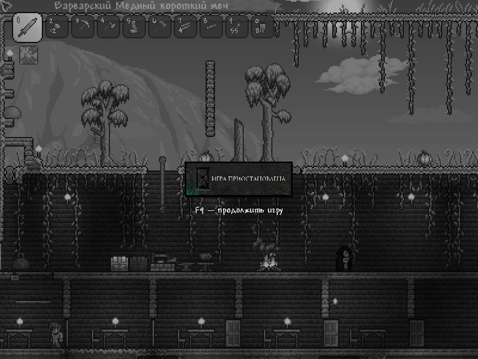

# HostPause for Terraria

**Press F9 as the host to pause the game for everyone. Press F9 again to resume after a short countdown.**

HostPause is a patch for **vanilla Terraria 1.4.5.8** that adds a real multiplayer pause:
the whole world freezes for every player, the screen turns gray and a pause banner appears.
It does not require tModLoader. A dedicated server can also be paused from its console.

[Русская инструкция](README_RU.md) · [Downloads](https://github.com/Abdeygodin/terraria-hostpause/releases)

**Playing tModLoader?** The [tModLoader edition](tmodloader/README.md) does the same as a regular
mod, without patching the game.



## Status

**Experimental prerelease, version 0.2.0.** Tested with the native Linux Steam Flatpak game,
an actual graphical FNA client, and a dedicated TCP server. The Windows x64 installer is
built, but Windows gameplay and Steam friend connections have not been tested live.
Other Terraria versions are unsupported.

## What is new in 0.2.0

- **Resume countdown.** Pressing F9 during a pause starts a 3-2-1 countdown, so nobody is
  caught off guard. Press F9 again during the countdown to cancel it and stay paused.
- **Dedicated server console.** Type `pause`, `resume` or `hostpause` (status) in the server
  console. It works with or without players online. A console pause is not released when the
  host leaves, and only the console can end it.
- **Who paused.** Players see whether the host or the server paused the game. Pause, resume
  and countdown have sounds.
- **No lost actions at the pause edge.** A block mined or an item moved a moment before the
  pause reached a player is now applied on the server too, instead of silently desyncing.
- **Settings file.** `HostPause.config.txt` sets the key and the countdown length.
- **Installer survives Steam updates.** `status` tells whether the patch is active. If Steam
  replaced the game files, running Install again repairs the patch. Installing over an
  earlier HostPause version upgrades it in place and keeps your settings.

**Everyone must update to 0.2.0, including the host and server.** It uses protocol 3 and
refuses shared pause with 0.1.x clients. Just run the 0.2.0 Install on each PC: it replaces
the earlier version automatically.

## Install and play

1. Everyone saves and fully closes Terraria and its server.
2. Download `HostPause-0.2.0.zip` from Releases and extract it.
3. Each player installs the patch: run `Install-Windows.cmd` on Windows or
   `bash Install-Linux.sh` on Linux.
4. Start Terraria through Steam as usual. The host starts a Host & Play session;
   the other players join.
5. Wait for the `HostPause 0.2.0 готов` message. The host presses **F9** to pause,
   and **F9** again to resume after the countdown.

If installation cannot locate the game, pass its directory explicitly:

```bash
bash Install-Linux.sh "/path/to/Terraria"
```

To check the installation, run `HostPause.Patcher status` from the `linux` or `windows`
folder of the archive (with the game directory as an optional argument).

Back up your characters and worlds before trying this prerelease. The installer backs up
the executables in `HostPause.backups` and does not edit save files.

## Settings

`HostPause.config.txt` next to `Terraria.exe`:

```
key=F9
countdown=3
```

- `key`: any XNA key name, for example `F8` or `Pause`. Choose a key nothing else uses
  (the TerrariaModder AdminPanel, for example, uses F9 for god mode).
- `countdown`: seconds before the game resumes, 0 to 10. `0` resumes instantly.
  In multiplayer the server's value applies.

Restart the game or server after editing. A 0.1.x `HostPause.key.txt` is moved into the
config automatically on upgrade.

## Behavior

- Only the host authenticated by Terraria's Host & Play token can pause and resume from
  the game. Joining first or using a local IP does not grant host rights. Other players
  see a neutral "only the host can resume" message rather than the host's key.
- The simulation stops: world time, enemies, projectiles, items, physics, damage and
  gameplay timers. Networking continues so the game can resume.
- Every connected player needs the patch. An unpatched or still-loading player prevents
  pausing; normal gameplay remains available.
- New joins are refused while paused. Reconnect after the game resumes.
- Leaving as host releases a host pause immediately, even during a countdown.
  Host & Play may also close its server.
- Console commands on a dedicated server: `pause` (or `пауза`), `resume` (or `продолжить`)
  and `hostpause` for the state. Typing `pause` while the host has paused takes the pause
  over for the console. Vanilla console commands such as `dawn` still reach paused players.
- F9 also pauses singleplayer, with the same countdown.
- Starting a pause is blocked while typing in chat, a sign, or a chest name.
  Resuming or cancelling remains available. Chat appears after resuming.
- If the pause visuals fail on some GPU, the pause itself keeps working without them.
  If the host's patch fails entirely, the server releases the pause at once.

## Uninstall or update

Close the game and server. Run `Uninstall-Windows.cmd` or `bash Uninstall-Linux.sh` to
restore the original executables. Settings you edited are kept for a later install.

If Steam already replaced the game files, uninstall leaves Steam's files alone and only
removes HostPause's own files. Compatibility with other patches is untested.

## Source and build

The repository contains the patch source, its banner, tests and verification evidence.
Release archives contain the installer and runtime for Linux x64 and Windows x64.
No Terraria executables, game libraries, characters, or worlds are distributed.
The patcher generates modified executables from the user's own game installation.

Requirements: Python 3, .NET SDK 8, and an original Terraria 1.4.5.8 installation.
Runtime compilation needs a .NET Framework `mscorlib.dll` reference: the native Linux game
includes one; the script also supports the Windows framework location.

```bash
python3 source/build.py "/path/to/original/Terraria"
dotnet source/build/HostPause.Patcher.dll prepare "/path/to/original/Terraria" "/new/staging/directory"
```

`prepare` writes patched files to a separate staging directory. To install the build, use
`dotnet source/build/HostPause.Patcher.dll install "/path/to/Terraria"`. The patcher
rejects unsupported assembly versions and already-patched inputs.

## Verification

All results come from controlled Linux runs; they are not Windows or Steam-friend tests.

- `verification/integration-result.json`: 31 checks against the real 1.4.5.8 server with
  independent protocol clients. They cover host rights, frozen simulation and player state,
  a 125-second pause, the countdown and its cancellation, actions in flight at the pause
  edge, mixed and outdated clients, host exit mid-countdown, and empty-server recovery.
- `verification/live-result.json`: console commands (also on an empty server and in a
  burst), console takeover of a host pause, plus the real graphical FNA client. The client
  checks the F9 pause, that the countdown held it at least 1.5 s, and that the frozen frame
  is grayscale. A graphical guest with a deliberately failed capture stays frozen until the
  server resumes it.
- `verification/installer-0.2.0-result.json`: upgrade from the real 0.1.2 installer, key
  migration, Steam replacing files, repair, partial replacement, and byte-identical
  uninstall on an isolated copy of the game.
- `verification/graphics-regression-result.json`: XNA Reach readback guard restoration and
  pause preservation after a graphics error.

The tests use isolated game copies and a synthetic localhost host token. They must not be
run against a live player session. `source/tests/prepare_testbed.py` builds the test bed.

**Known vanilla issue:** a vanilla 1.4.5.8 Linux dedicated server can crash with
`ObjectDisposedException` when a TCP connection opens and closes immediately (port checks,
uptime monitors). This happens without HostPause too; HostPause does not change it.

## License and affiliation

HostPause code is under the [MIT License](LICENSE). Mono.Cecil and the bundled .NET runtime
have their accompanying license notices. Terraria belongs to Re-Logic; this is an
unofficial community project.
