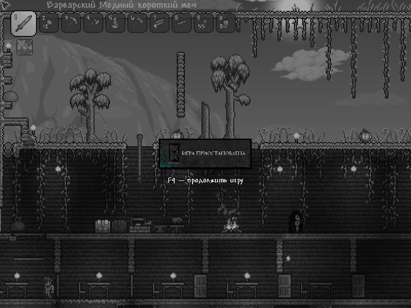

# HostPause 0.2.0 (предварительный выпуск) — Terraria 1.4.5.8

**F9 у хоста ставит игру на паузу для всех. Повторное F9 продолжает игру после короткого отсчёта.**

Это патч обычной Terraria, без tModLoader. Он предназначен для Terraria **1.4.5.8**:
мир замирает у всех игроков, экран становится серым, по центру — баннер паузы.
Выделенный сервер можно поставить на паузу командой из его консоли.

Проверен на Linux с файлами Steam Flatpak: отдельный TCP-сервер и настоящий
графический клиент. Установщик Windows x64 собран, но сама Windows и подключение
через Steam к другу пока не проходили живую проверку.



[Скачать предварительный выпуск](https://github.com/Abdeygodin/terraria-hostpause/releases/tag/v0.2.0)

## Что нового в 0.2.0

- **Отсчёт перед продолжением.** F9 во время паузы запускает отсчёт 3-2-1, чтобы никого
  не застали врасплох. Повторное F9 во время отсчёта отменяет его — пауза продолжается.
- **Консоль выделенного сервера.** Команды `pause` (`пауза`), `resume` (`продолжить`) и
  `hostpause` (состояние). Работают и на пустом сервере. Паузу из консоли не снимает
  выход хоста, а закончить её можно только из консоли.
- **Кто поставил паузу.** Игроки видят, поставил её хост или сервер. У паузы,
  продолжения и отсчёта есть звуки.
- **Действия на границе паузы не теряются.** Блок, выкопанный за мгновение до того, как
  пауза дошла до игрока, теперь применяется и на сервере, а не пропадает молча.
- **Файл настроек** `HostPause.config.txt`: клавиша и длина отсчёта.
- **Установщик переживает обновления Steam.** Команда `status` показывает, работает ли
  патч. Если Steam заменил файлы игры, повторный Install восстановит патч. Установка
  поверх прошлой версии HostPause обновляет её на месте и сохраняет настройки.

**Обновление требуется хосту, серверу и каждому игроку.** Используется протокол 3;
со старыми версиями 0.1.x совместная пауза намеренно не включается. Достаточно
запустить Install из 0.2.0 на каждом компьютере — прошлая версия заменится сама.

## Установка

1. Сохранитесь и полностью закройте Terraria и сервер у всех участников.
2. Распакуйте архив. На Linux выполните `bash Install-Linux.sh`.
   На Windows запустите `Install-Windows.cmd`.
3. Установите этот же патч на компьютере каждого игрока.
4. Запускайте Terraria из Steam как обычно. Хост создаёт игру через
   «Многопользовательская игра → Создать и играть».
5. После подключения игроков дождитесь сообщения «HostPause 0.2.0 готов».
   Хост нажимает **F9** для паузы и ещё раз **F9** для продолжения.

Если игра не обнаружена автоматически, передайте установщику папку, где находится
`Terraria.exe`: `bash Install-Linux.sh "/путь/к/Terraria"`.

Проверить установку: `HostPause.Patcher status` из папки `linux` или `windows` архива
(папку игры можно передать аргументом).

## Настройки

`HostPause.config.txt` рядом с `Terraria.exe`:

```
key=F9
countdown=3
```

- `key` — клавиша, например `F8` или `Pause`. Выбирайте свободную: например,
  TerrariaModder AdminPanel использует F9 для режима бессмертия.
- `countdown` — секунды до продолжения, от 0 до 10; `0` — сразу. В мультиплеере
  действует значение сервера.

После изменения перезапустите игру или сервер. Клавиша из `HostPause.key.txt`
версии 0.1.x переносится в этот файл при обновлении автоматически.

## Поведение

- В одиночной игре F9 работает локально, с тем же отсчётом.
- По сети ставить и снимать паузу из игры может только хост с подтверждённым
  Terraria токеном Host & Play. Первый подключившийся игрок и игрок с локальным IP
  это право не получают. Остальные игроки видят «продолжить может хост», а не
  клавишу хоста.
- Останавливаются игровая симуляция, враги, снаряды, физика, урон, таймеры,
  предметы в мире и течение игрового времени. Сеть продолжает работать.
- При отсутствии патча у одного из участников пауза не включается, обычная игра
  остаётся доступной. Нужно также дождаться завершения подключения всех игроков.
- Во время паузы новые подключения отклоняются с сообщением «Игра на паузе».
- При выходе хоста его пауза снимается сразу, даже во время отсчёта. Сам Host & Play
  при этом может штатно закрыть сервер.
- `pause` в консоли во время паузы хоста передаёт паузу консоли. Обычные команды
  консоли вроде `dawn` доходят до игроков и во время паузы.
- Если открыт чат или ввод имени сундука/таблички, включение паузы не срабатывает.
  Продолжить или отменить отсчёт можно и при открытом чате.
- Если графические эффекты не поддерживаются, пауза работает без них. Если патч
  у хоста полностью отказал, сервер сразу снимает паузу.

## Диагностика

В папке игры создаётся `HostPause.log`: версия, согласование протокола,
полученные команды паузы/продолжения и ошибки. Имена игроков, Steam ID и токены
подключения патч в этот журнал не записывает.

## Резервная копия и удаление

Установщик сначала сохраняет исходные файлы в `HostPause.backups` внутри папки игры,
затем проверяет копии и меняет два исполняемых файла. Сохранения персонажей и миров
он не редактирует.

Для удаления закройте игру и выполните `bash Uninstall-Linux.sh` либо запустите
`Uninstall-Windows.cmd`. Удаление восстанавливает исходные файлы байт в байт;
изменённые вами настройки остаются для следующей установки. Если Steam уже заменил
файлы игры, удаление их не трогает и убирает только файлы HostPause.

## Что проверено

Все проверки — управляемые прогоны на Linux, не Windows и не Steam-подключение к другу.

- `verification/integration-result.json` — 31 проверка настоящего сервера 1.4.5.8
  с независимыми клиентами протокола: права хоста, замороженная симуляция, пауза
  на 125 секунд, отсчёт и его отмена, действия на границе паузы, клиенты без патча и
  старых версий, выход хоста во время отсчёта, восстановление пустого сервера.
- `verification/live-result.json` — команды консоли (в том числе на пустом сервере и
  пачкой), передача паузы хоста консоли, настоящий графический клиент FNA: пауза по F9,
  отсчёт держал паузу не меньше 1,5 с, замороженный кадр серый. Графический гость с
  искусственной ошибкой захвата кадра остаётся на паузе до команды сервера.
- `verification/installer-0.2.0-result.json` — обновление с настоящего установщика 0.1.2,
  перенос клавиши, замена файлов Steam, восстановление, частичная замена и побайтовое
  удаление на отдельной копии игры.
- `verification/graphics-regression-result.json` — ограничение XNA Reach и сохранение
  паузы при ошибке графики.

**Известная проблема самой игры:** выделенный сервер 1.4.5.8 на Linux может упасть с
`ObjectDisposedException`, если TCP-подключение открывается и сразу закрывается
(проверка порта, мониторинг). Это происходит и без HostPause; патч этого не меняет.

## Исходники

В `source` лежат Runtime.cs, установщик, скрипт сборки и тесты. Для сборки нужны
.NET SDK 8 и оригинальные файлы вашей Terraria:

```bash
python3 source/build.py "/путь/к/Terraria"
dotnet source/build/HostPause.Patcher.dll prepare "/путь/к/Terraria" "/новая/папка"
```

Сам патч не распространяет исполняемые файлы Terraria: установщик создаёт изменённые
файлы из вашей установленной копии. Сетевой протокол патча — пакет 254 с сигнатурой
HPZ1 и версией 3. Формат сохранений не меняется, новые элементы в мир не добавляются.
