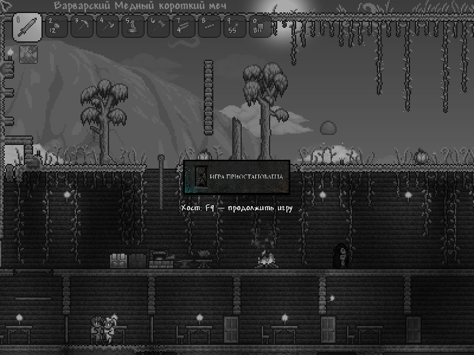

# HostPause 0.1.1 (предварительный выпуск) — Terraria 1.4.5.8

**F9 у хоста ставит игру на паузу для всех. Повторное F9 продолжает игру.**

Это патч обычной Terraria, без tModLoader. Он предназначен для Terraria **1.4.5.8**.
Проверен на Linux с файлами Steam Flatpak: отдельный TCP-сервер и настоящий
графический клиент. Установщик Windows x64 собран, но сама Windows и подключение
через Steam к другу в этом выпуске пока не проходили живую проверку.

В 0.1.1 исправлен сбой установщика Windows «Failed to resolve assembly:
Microsoft.Xna.Framework.Graphics»: добавлен поиск XNA в системном GAC и сборок
.NET Framework. Ошибка воспроизведена на официальном Windows-сервере 1.4.5.8,
исправление проверено на Linux с имитацией структуры GAC Windows. Это не
равнозначно проверке самой игры на Windows.

Если установка 0.1.0 завершилась именно этой ошибкой, распакуйте новый архив
в отдельную папку и повторите `Install-Windows.cmd`; удаление патча не требуется.
Если старая версия успешно установлена, сначала удалите её через Uninstall.



[Скачать предварительный выпуск](https://github.com/Abdeygodin/terraria-hostpause/releases/tag/v0.1.1)

## Установка

1. Сохранитесь и полностью закройте Terraria и сервер у всех участников.
2. Распакуйте архив. На Linux выполните `bash Install-Linux.sh`.
   На Windows запустите `Install-Windows.cmd`.
3. Установите этот же патч на компьютере каждого игрока.
4. Запускайте Terraria из Steam как обычно. Хост создаёт игру через
   «Многопользовательская игра → Создать и играть».
5. После подключения игроков дождитесь сообщения «HostPause готов».
   Хост нажимает **F9** для паузы и продолжения.

Если игра не обнаружена автоматически, передайте установщику папку, где находится
`Terraria.exe`: `bash Install-Linux.sh "/путь/к/Terraria"`.

Клавишу можно поменять в `HostPause.key.txt` рядом с Terraria.exe, например на
`F8` или `Pause`. После изменения перезапустите игру. Выбирайте свободную клавишу.
Если открыт чат или ввод имени сундука/таблички, включение паузы не срабатывает.
Снять уже включённую паузу хост может клавишей F9 даже при открытом чате.

## Поведение

- В одиночной игре F9 работает локально.
- По сети управление разрешено только хосту с подтверждённым Terraria токеном
  Host & Play. Первый подключившийся игрок и игрок с локальным IP автоматически
  не получают это право.
- Останавливаются игровая симуляция, враги, снаряды, физика, урон, таймеры,
  предметы в мире и течение игрового времени. Кадр игры замирает, становится серым
  и затемняется; по центру отображается компактная картинка «Игра приостановлена».
  Сеть продолжает работать, чтобы хост мог снять паузу.
- При отсутствии патча у одного из участников пауза не включается, обычная игра
  остаётся доступной. Нужно также дождаться завершения подключения всех игроков.
- Во время паузы новые подключения отклоняются с сообщением «Игра на паузе».
  Повторите подключение после продолжения игры.
- При выходе хоста пауза автоматически снимается. Сам Host & Play при этом может
  штатно закрыть сервер — патч не превращает его в постоянно работающий сервер.
- Изменения мира по сети во время паузы отбрасываются. Чат будет виден после
  продолжения игры. Дополнительные моды и патчи совместно с HostPause не проверялись.

## Резервная копия и удаление

Установщик сначала сохраняет исходные файлы в `HostPause.backups` внутри папки игры,
затем проверяет копии и меняет два исполняемых файла. Сохранения персонажей и миров
он не редактирует. В `HostPause.install.json` находятся пути отката и контрольные суммы.

Для удаления закройте игру и выполните `bash Uninstall-Linux.sh` либо запустите
`Uninstall-Windows.cmd`. Удаление восстанавливает исходные файлы байт в байт.

Проверка файлов в Steam и обновление Terraria могут заменить патч. Не устанавливайте
этот выпуск на другую версию игры. Если файлы игры изменились после установки,
установщик откажется восстанавливать старые исполняемые файлы поверх обновления.
В таком случае используйте штатную проверку целостности Terraria в Steam.

## Что проверено

`verification/integration-result.json` содержит 19 проверок настоящего Linux-сервера
1.4.5.8 с двумя независимыми TCP-клиентами: права хоста, синхронизацию паузы,
остановку игрового счётчика и времени, координат NPC и снаряда, здоровья и позиции
игрока, паузу на 125 секунд, продолжение, смешанный состав клиентов, выход хоста
и восстановление подключений к пустому серверу. Графический клиент дополнительно
проверяет F9, остановку/продолжение симуляции и сохраняет снимок паузы с баннером.
Установка и удаление дополнительно проверены на отдельной копии файлов игры.
`verification/resolver-result.json` описывает проверки поиска зависимостей Windows
и побайтового совпадения результата патчера Linux с проверенным выпуском 0.1.0.

## Исходники

В `source` лежат Runtime.cs, установщик, скрипт сборки и тесты. Для сборки нужны
.NET SDK 8 и оригинальные файлы вашей Terraria:

```bash
python3 source/build.py "/путь/к/Terraria"
dotnet source/build/HostPause.Patcher.dll prepare "/путь/к/Terraria" "/новая/папка"
```

Сам патч не распространяет исполняемые файлы Terraria: установщик создаёт изменённые
файлы из вашей установленной копии. Сетевой протокол патча — пакет 254 с сигнатурой
HPZ1 и версией 1. Формат сохранений не меняется, новые элементы в мир не добавляются.
