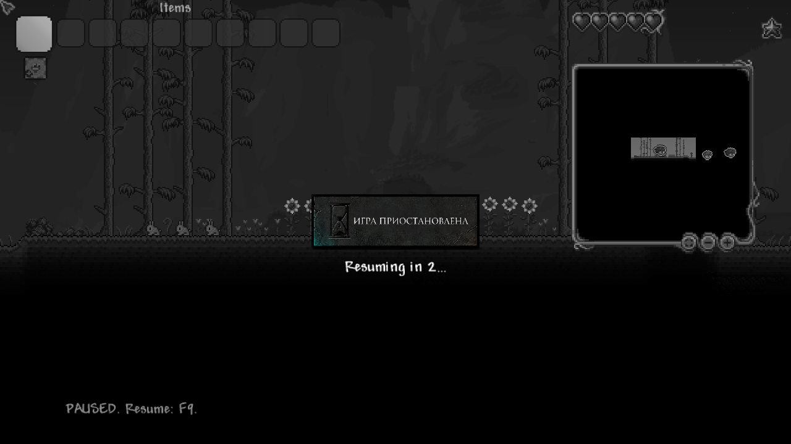

# HostPause for tModLoader

**The host presses a key and the whole world freezes for every player. Pressing it again
resumes the game after a short countdown.**

This is the tModLoader edition of [HostPause](../README.md). It does the same job as the
vanilla 1.4.5.8 patch in `source/`, but it is an ordinary tModLoader mod: no installer and
no changes to game files.
Built and tested with tModLoader v2026.08.3 (the 1.4.4 stable branch).

[Русская версия ниже](#по-русски)



## Install

HostPause is on the Steam Workshop: [HostPause](https://steamcommunity.com/sharedfiles/filedetails/?id=3839806721). To install it:

1. In tModLoader open **Workshop → Download Mods**, search for **HostPause**, download it,
   then enable it in **Workshop → Manage Mods** and reload.
2. The server (or the Host & Play host) needs it. Players without it are offered the mod
   automatically when they join, as long as tModLoader's "Download mods from servers"
   option is on. tModLoader also makes sure everyone runs the same version.
3. Choose a pause key: **Settings → Controls**, HostPause section. tModLoader leaves mod
   keys unbound until you pick one. "Reset to default" there gives HostPause **F9**.
   Until a key is bound, `/pause` and `/resume` in chat do the same thing.

A dedicated server gets the mod with the rest of its mods (copy `HostPause.tmod` into its
`Mods` folder and enable it, or use the server's Workshop download).

## Use

- **Pause key** (F9 if you bind it that way): pause; during a pause start the resume
  countdown; during the countdown cancel it and stay paused.
- **Chat:** `/pause`, `/resume`, `/hostpause` (status). Same rules as the key.
- **Server console:** `pause`, `resume`, `hostpause`. Russian aliases: `пауза`, `продолжить`.
  A console pause can only be ended from the console. Typing `pause` while the host has
  paused takes the pause over for the console.
- **Single player:** the key and `/pause` work the same way, with the countdown.

While paused the screen turns gray with the HostPause banner and a caption saying who
can resume. Inventory and other UI are not drawn, so nothing can be changed mid-pause.
Chat still works and shows up again after resuming.

## Who counts as the host

There is no Host & Play token in tModLoader, so HostPause uses tModLoader's own host rule
(`NetMessage.DoesPlayerSlotCountAsAHost`, the same check that guards Journey mode powers
and in-game edits of server configs): **the player connected from the server's own machine**.

- **Host & Play:** the player who started it is the host. Over Steam, tModLoader identifies
  the host by its Steam ID.
- **Dedicated server:** the console is always in control. A player who runs the game on the
  same machine as the server also counts as the host. Remote players do not.
- **Tunnels and proxies:** services such as playit.gg, ngrok or SSH port forwarding deliver
  remote players from `127.0.0.1`, so the server sees *every* player as local. Behind such a
  tunnel everyone counts as the host. This is a tModLoader rule, not something HostPause can
  tell apart.
- **Server config "Any player can pause":** lets every player pause and resume. Such a pause
  lasts while at least one player is online.

A pause started by the host ends at once when no player who may resume it is left
(the host leaving, crashing or timing out), even during the countdown.

## Settings

Server-side mod config (**Settings → Mod Configuration → HostPause**, or
`ModConfigs/HostPause_PauseConfig.json` on a dedicated server):

| Setting | Default | Meaning |
|---|---|---|
| Resume countdown | 3 | Seconds counted down before resuming, 0 to 10. 0 resumes instantly. |
| Any player can pause | off | Off: host and console only. On: every player. |

In multiplayer the server's values apply. tModLoader only accepts in-game edits of server
configs from the host.

## What stops while paused

The mod skips Terraria's whole world update (`Main.DoUpdate` after networking and input,
before `UpdateWindyDayState`): players, NPCs, projectiles, items, liquids, time, events,
weather and every mod hook that runs inside the world update. Networking keeps running.

- New joins are refused while paused with "The game is paused. Join again after it resumes".
- Pausing is refused while someone is still joining.
- Gameplay a player sent just before the pause reached them (a mined block, a moved item)
  is still applied on the server, so the world does not desync at the pause edge.
- Other mods' network packets (ModPacket) are not blocked, only the simulation is. A mod
  that changes the world directly from a packet handler can still do so during a pause.

## Differences from the vanilla patch

| | Vanilla patch (`source/`) | tModLoader edition |
|---|---|---|
| Game | Terraria 1.4.5.8 | tModLoader 1.4.4 (v2026.08) |
| Install | Installer patches the game files | Workshop mod, no game files touched |
| Who is the host | Host & Play token | Player on the server's machine (tModLoader rule), optional "any player" |
| Key | `HostPause.config.txt`, F9 by default | Controls menu; unbound until set (F9 suggested); `/pause` works meanwhile |
| Countdown setting | Config file | Server-side mod config, editable in game by the host |
| Version check | Own protocol; unpatched players block pausing | tModLoader requires everyone to run the same mod version |
| Chat commands | None | `/pause`, `/resume`, `/hostpause` |
| Language | Russian | English and Russian, following the game language (banner stays Russian) |
| Packets from the server during a pause | Mostly dropped | Applied, which keeps clients in sync |
| Other mods | Not applicable | Their world updates freeze; their packets pass through |

Unchanged from vanilla: the frozen gray frame and banner, the countdown and its
cancellation, refusing joins, releasing a host pause when the host leaves, console
commands and takeover, the pause-edge acknowledgement, the Lighting F9 toggle suppressed
while F9 is the pause key, and the fail-safe that releases the pause if the mod errors.

## Build from source

Put the `HostPause` folder (or a link to it) into tModLoader's `ModSources` folder and use
**Workshop → Develop Mods → Build**. Or, from this folder:

```bash
dotnet build HostPause/HostPause.csproj -p:tMLInstallDir=/path/to/tModLoader
```

The built `HostPause.tmod` lands in tModLoader's `Mods` folder.
Publishing to the Workshop is done from **Develop Mods → Publish** in tModLoader.

## Verification

Tested on Linux with tModLoader v2026.08.3: a local dedicated server plus two real
tModLoader clients. The clients ran with full graphics in a private, invisible KWin
compositor and connected over TCP. The host connected from `127.0.0.1`, the guest from the
machine's LAN address, so the server treated the guest as a remote player.

Verified:

- Only the host can pause and resume. The guest is refused by key and by `/pause` and
  `/resume`; with "Any player can pause" the guest can pause.
- Full freeze on the server and both clients: world time, NPC positions and a guest who
  kept walking all stayed still for the whole pause and moved again after resuming.
- Countdown (3-2-1), cancelling it with the key, resuming, and `ResumeCountdown = 0`.
- Gray frozen frame with banner and the right caption for host, guest and single player.
- Console `pause`, `resume`, `hostpause`, also on an empty server; console takeover of a host
  pause; the host then being refused.
- A late joiner refused while paused, with the message shown on their screen.
- Host client killed mid-pause: the server released the pause within about 1.5 s.
- Pause edge: the guest toggled a tile every tick while the host paused; at six
  different pause moments the tile row was identical on the server, host and guest.
- Single player pause, countdown, cancel and resume.

Not verified:

- Windows and macOS.
- Host & Play over Steam (the Steam ID host check) and the Workshop download flow.
- A physical key press: the tests set the keybind's "just pressed" state in the frame where
  the game reads it; binding the key in the Controls menu was not exercised.
- Other GPUs than the Intel one used here, and compatibility with other mods.

The test tools are in `tests/`: `HostPauseTestBot` (a test-only mod that joins, presses the
key, walks, edits tiles, logs world state and takes screenshots) and `SteamlessContinueHook`
(a startup hook that clicks past tModLoader's Steam notice in a client run without Steam).
Never publish them.

---

## По-русски

**Хост нажимает клавишу, и мир замирает у всех игроков. Повторное нажатие продолжает игру
после короткого отсчёта.** Это версия HostPause для tModLoader (ветка 1.4.4,
проверено на v2026.08.3). Игровые файлы не меняются.

### Установка

Мод опубликован в Мастерской Steam: [HostPause](https://steamcommunity.com/sharedfiles/filedetails/?id=3839806721). Установка:

1. В tModLoader: **Мастерская → Загрузить моды**, найдите **HostPause**, скачайте, включите
   в **Управлении модами** и перезагрузите моды.
2. Мод нужен серверу (или хосту Host & Play). Остальным игрокам tModLoader предложит его
   скачать при подключении, если включено «Скачивать моды с серверов».
3. Назначьте клавишу паузы: **Настройки → Управление**, раздел HostPause. tModLoader не
   назначает клавиши модов сам; «Сбросить по умолчанию» даст **F9**. Пока клавиши нет,
   работают команды `/pause` и `/resume` в чате.

### Управление

- **Клавиша паузы:** пауза; на паузе — отсчёт до продолжения; во время отсчёта — отмена.
- **Чат:** `/pause`, `/resume`, `/hostpause` (состояние).
- **Консоль сервера:** `pause` (`пауза`), `resume` (`продолжить`), `hostpause`. Паузу из
  консоли снимает только консоль; `pause` во время паузы хоста передаёт её консоли.

### Кто считается хостом

В tModLoader нет токена Host & Play, поэтому HostPause использует правило самого tModLoader:
**хост — игрок, подключённый с компьютера, на котором запущен сервер**. В Host & Play это тот,
кто его запустил. На выделенном сервере паузой управляет консоль и игрок на той же машине.
Через туннели (playit.gg, ngrok, проброс SSH) все игроки приходят с `127.0.0.1` и считаются
хостами. В настройках сервера можно разрешить паузу всем игрокам.

Пауза хоста снимается сразу, когда на сервере не остаётся игрока, который может её снять.

### Настройки

Серверная конфигурация мода: «Отсчёт перед продолжением» (0–10 с, по умолчанию 3) и
«Пауза доступна всем игрокам» (выключено).

### Отличия от патча для обычной Terraria

Установка через Мастерскую вместо патчера; хост определяется правилом tModLoader, а не
токеном Host & Play; клавиша назначается в меню управления; отсчёт — в конфигурации мода;
версию у всех игроков проверяет tModLoader; добавлены команды чата; тексты на английском
и русском по языку игры. Заморозка мира, серый кадр, отсчёт, отказ в подключении на паузе,
снятие паузы при уходе хоста, консоль и защита от потери действий на границе паузы — как в
обычной версии. Подробная таблица и результаты проверки — в английской части выше.
